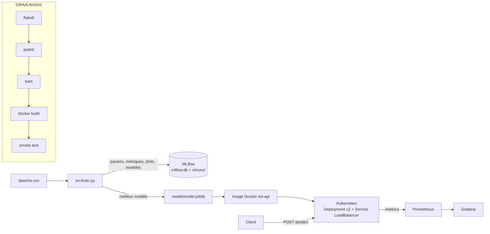

# Iris MLOps – du modèle au déploiement

Projet MLOps de bout en bout : un classifieur Iris entraîné et suivi avec **MLflow**, servi par une API **FastAPI**,
empaqueté avec **Docker**, testé et construit par **GitHub Actions**, déployé sur **Kubernetes** et surveillé avec
**Prometheus + Grafana**.

## Architecture



## Structure

```
data/iris.csv              jeu de données
src/train.py               entraînement + MLflow + export du meilleur modèle
src/app.py                 API FastAPI (/predict, /health, /metrics) + logs des requêtes
tests/test_pipeline.py     tests unitaires (données, modèle, API)
Dockerfile                 image de l'API
docker-compose.yml         API + Prometheus + Grafana
monitoring/                config Prometheus et dashboard Grafana
k8s/                       manifestes Kubernetes
.github/workflows/ci.yml   pipeline CI/CD
```

## 1. Installation (une seule fois)

PowerShell :

```powershell
python -m venv .venv
.venv\Scripts\Activate.ps1
pip install -r requirements.txt
```

## 2. Entraînement + suivi des expériences

```powershell
python src/train.py
mlflow ui --backend-store-uri sqlite:///mlflow.db     # http://localhost:5000
```

Deux modèles (Logistic Regression, Random Forest) sont entraînés. Pour chacun, MLflow enregistre les hyperparamètres,
l'accuracy en validation croisée, accuracy/precision/recall/F1 sur le test, la matrice de confusion et le modèle.
Le meilleur (F1 test) est exporté dans `model/`.

## 3. Tests

```powershell
flake8 src tests
pytest -v
```

## 4. API en local (sans Docker)

```powershell
uvicorn app:app --app-dir src --port 8000
```

Swagger : http://localhost:8000/docs

```powershell
curl.exe -X POST http://localhost:8000/predict -H "Content-Type: application/json" `
  -d '{\"sepal_length\":5.1,\"sepal_width\":3.5,\"petal_length\":1.4,\"petal_width\":0.2}'
```

Réponse :

```json
{"prediction": 0, "species": "setosa", "confidence": 0.98, "probabilities": {"setosa": 0.98, "versicolor": 0.02, "virginica": 0.0}}
```

## 5. Docker + monitoring

```powershell
python src/train.py                 # le modèle doit exister avant le build
docker compose up --build -d
```

| Service    | URL                          |
|------------|------------------------------|
| API        | http://localhost:8000/docs   |
| Prometheus | http://localhost:9090        |
| Grafana    | http://localhost:3000 (admin / admin) → dashboard « Iris API » |

Arrêt : `docker compose down`

## 6. Déploiement Kubernetes (Docker Desktop)

Prérequis : Docker Desktop → Settings → Kubernetes → **Enable Kubernetes**.

```powershell
docker build -t iris-api:latest .
kubectl config use-context docker-desktop
kubectl apply -f k8s/
kubectl get pods,svc
```

L'API est exposée par le LoadBalancer sur http://localhost:8080/docs

Nettoyage : `kubectl delete -f k8s/`

## 7. CI/CD

À chaque push sur `main`, `.github/workflows/ci.yml` exécute : lint → tests → entraînement → build Docker →
smoke test du conteneur, puis publie le modèle et le rapport de tests comme artefacts. Le pipeline échoue dès qu'une
étape échoue.
